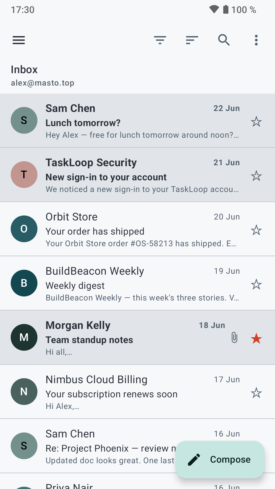
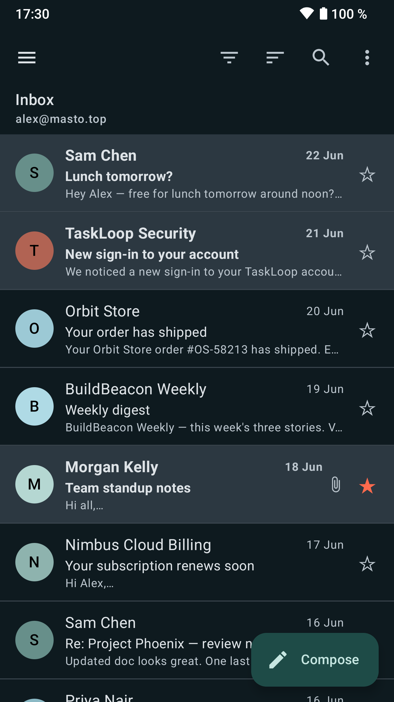
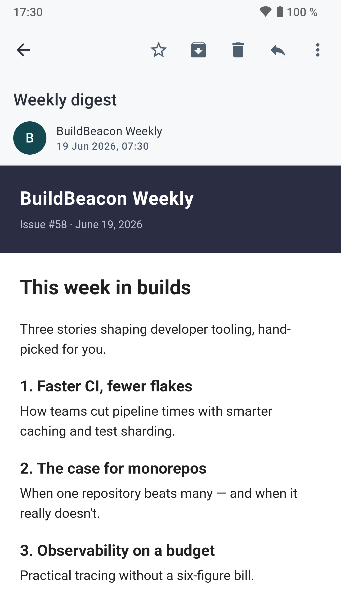
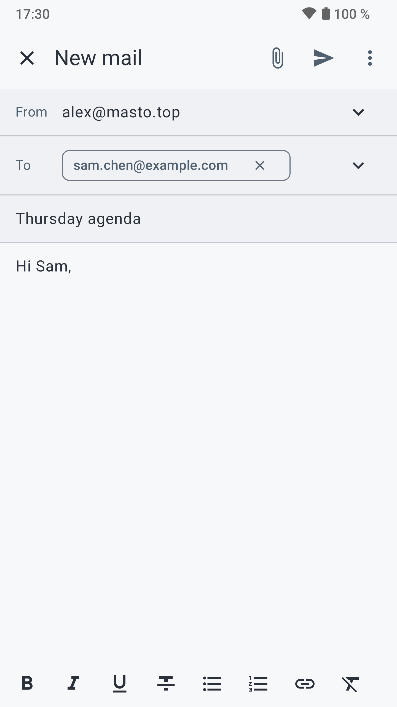
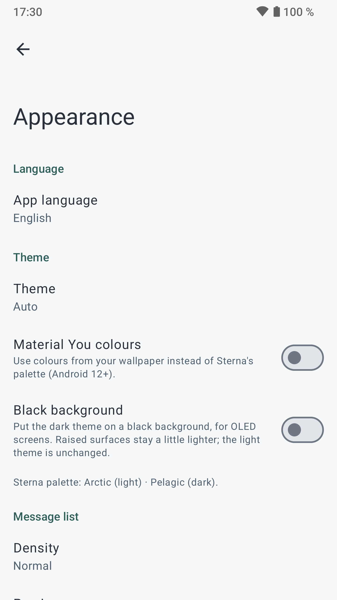

<p align="center">
  
</p>

<h1 align="center">Sterna Mail Extended</h1>

<p align="center">
  <b>All your mail. None of the baggage.</b><br>
  A fast, private <b>JMAP email client for Android</b>, fluent in classic <b>IMAP/SMTP</b> too.<br>
  No ads. No tracking. No Google. ✨
</p>

<p align="center">
  A fork of <a href="https://codeberg.org/emon/sterna-mail">Sterna Mail</a> by emon
  (<a href="https://sternamail.org">sternamail.org</a>)
</p>

<p align="center">
  <a href="https://github.com/btafoya/sterna-mail-extended"></a>
  <a href="https://codeberg.org/emon/sterna-mail"></a>
  <a href="https://sternamail.org"></a>
  
  <a href="LICENSE"></a>
  <a href="https://ko-fi.com/emoncode"></a>
</p>

> ### 🍴 Sterna Mail Extended: a fork
>
> This repository is a **fork of [Sterna Mail](https://codeberg.org/emon/sterna-mail)
> by [emon](https://codeberg.org/emon)**, who designed, wrote and maintains the
> original app. All credit for the client, its design and its privacy-first
> approach belongs to the original project and its author; this fork keeps the
> GPLv3 licence and the full upstream history. Please support the original at
> [sternamail.org](https://sternamail.org) and [Ko-fi](https://ko-fi.com/emoncode).
>
> **What the fork adds**, for JMAP servers that offer them (each entry appears in
> the drawer only when the account's server lists the capability):
>
> - **Calendars and tasks**: events and tasks, agenda and month views, an editor,
>   recurring events, and local reminders.
> - **Calendar invites**: RSVP from the invite card through `CalendarEvent/set`, so
>   the server sends the reply.
> - **Contacts**: browse and edit contact cards, not just autocomplete.
> - **Files**: browse, upload and download files on the server, and attach one
>   from the composer.
> - **Offline writes**: changes are queued on the phone and sent when the server
>   is reachable; a write the server refuses stays visible instead of vanishing.
>
> The fork is not distributed through F-Droid, Obtainium or the original's
> releases: build it from source ([CONTRIBUTING.md](CONTRIBUTING.md)). Features
> that are not listed above are the original's. Bugs in the fork's additions
> belong in [this repository's issues](https://github.com/btafoya/sterna-mail-extended/issues),
> not the upstream tracker.

Sterna Mail is open-source and built for **JMAP**, the new and faster internet
standard for email, with full support for classic **IMAP/SMTP** too. Just your
mail, on the server *you* choose.

> _Named after **Sterna**, the genus of terns 🐦, the Arctic tern flies the
> longest migration of any animal, carrying itself clear across the world and back
> every single year. I liked the idea of mail that travels light and always finds
> its way home._

> **Status: released, and under active development.** Sterna is a complete,
> daily-drivable email client: read, organise, search, write, schedule, and send
> mail (with attachments) over JMAP or IMAP/SMTP, across multiple accounts, fully
> offline-capable, with OpenPGP encryption, push notifications, and remote
> content blocked by default. Hit a rough edge? Please tell me about it!

## 📸 A look

| Inbox (light) | Inbox (dark) | Reading | Compose | Appearance |
|:---:|:---:|:---:|:---:|:---:|
|  |  |  |  |  |

*Light "Arctic" and dark "Pelagic" themes, a calm sea-teal accent with a warm
coral touch, the tern's beak. 🪸*

## 📲 Install

This fork is **not** published on F-Droid, Obtainium or the original's release
page, and has no release APKs of its own yet: **build it from source** with
[CONTRIBUTING.md](CONTRIBUTING.md), or install a debug build straight to a phone:

```
./gradlew assembleDebug
adb install -r app/build/outputs/apk/debug/app-debug.apk
```

Just want the original, unmodified app? Get it from
[F-Droid](https://f-droid.org/packages/app.sterna/) or the
[original releases](https://codeberg.org/emon/sterna-mail/releases/latest); those
builds are reproducible and signed with the original author's key, **not** this
fork's. The two share the package name `app.sterna`, so Android will not install
one over the other unless they are signed with the same key: uninstall first when
switching.

Prefer to build it yourself? See [CONTRIBUTING.md](CONTRIBUTING.md).

## 🤔 Why JMAP?

Most email apps talk to your server using an old protocol called IMAP. **JMAP** is
its modern successor: it syncs faster, uses less battery and data, and was designed
for today's phones. Servers like [Stalwart](https://stalw.art/) speak JMAP, and
Sterna is built to make the most of it. ⚡

Sterna also speaks classic **IMAP and SMTP**, so it works with any standard mail
provider, pick the protocol when you add an account, or just type your email and
let autodiscovery find the server for you.

Running your own server, with a free certificate or one you issued yourself? See
[Self-hosted server: getting its certificate accepted](docs/SELF-HOSTED-TLS.md).

## 💚 What Sterna stands for

- **🔒 Privacy first.** No tracking, no ads, no analytics, no Google services.
  Remote images and tracking pixels are blocked by default; tapped links can be
  stripped of tracking parameters and confirmed before opening.
- **🆓 Free and open.** Licensed under the GPLv3, anyone can read, audit, and
  improve the code.
- **🎨 Modern and calm.** A clean, fast Material 3 interface with its own brand
  identity that follows your phone's theme and language.

## ✨ Features

**📥 Reading & organising**
- Unified inbox across multiple accounts (JMAP and/or IMAP/SMTP), fully offline
  (local cache); the unified list shows what is cached, and a single JMAP folder
  pages in older mail from the server as you scroll (on IMAP a folder stops at
  the sync window)
- Conversation view, threads collapse into one row with a message count
- Nested folders shown as a collapsible tree; create / rename / delete, plus
  subfolders
- Configurable swipe actions, star, archive & delete with undo, multi-select
  bulk actions, snooze, report spam, empty trash (with undo), sort, and
  unread-only, starred-only and has-attachment filters
- Search-as-you-type (server-side + instant local results) with filters as chips
  under the search bar (unread, starred, has-attachment, from, recipient in To or
  Cc, subject, date); Trash and Spam are left out
- Calendar invites preview as an event card; one tap adds them to your calendar
  app (no calendar permission needed)

**✍️ Writing & sending**
- Compose with recipient chips + autocomplete and email validation, multiple
  identities each with its own signature, attachments, and drafts
- Undo send, schedule send (with a screen to view/cancel pending sends), and
  "forgot attachment?" / large-recipient-list reminders
- Opens `mailto:` links from any app or browser, prefilled (addresses, subject,
  body, cc/bcc)

**🔑 Accounts & setup**
- Add an account with just email + password (`/.well-known/jmap` autodiscovery),
  password-free **OAuth 2.0** sign-in (device flow, or the authorization code
  grant with PKCE through the browser where a server has no device endpoint or
  asks clients to register, Sterna then registering itself at each sign-in), or
  manual IMAP/SMTP with provider presets; a "test connection" button before saving
- Per-account colour, a photo picked on the phone that stays in the app, sync
  window, and a "Sync new mail" switch governing that
  account's background fetch and its notifications; encrypted credential
  storage (AndroidKeyStore); app lock (biometric / PIN)

**🔒 Encryption**
- **OpenPGP** (via an external OpenPGP app such as
  [OpenKeychain](https://f-droid.org/packages/org.sufficientlysecure.keychain/)):
  read and send signed and/or encrypted mail (PGP/MIME) on both JMAP and
  IMAP/SMTP. Decrypted content, OpenPGP or S/MIME alike, is never written to
  disk, with attachments as the exception: one you open is written to the app's
  own storage until the cache is cleared, and one you save goes to the folder
  you pick and stays there.
  Printing a message, or saving it as a PDF, hands its decrypted text to the
  system print service. A reply quoting decrypted text that you confirm sending
  or saving unencrypted is stored like any other reply. See the [encryption guide](ENCRYPTION.md) to get started.
- **S/MIME**: the signature of a received message is checked when you open it,
  on both JMAP and IMAP. A message encrypted for your RSA certificate is
  decrypted with that certificate, installed in Android's settings and picked
  the first time you tap Unlock. Once that certificate is chosen in the
  account's settings, a message you send can be signed, or signed and
  encrypted. Encrypting needs a certificate for each recipient: Sterna keeps
  one from a signed message the recipient sent you, once its signature checks
  out. The subject is not encrypted, and an encrypted message can't have Bcc
  recipients.

**🔔 Notifications & server power**
- Push for new mail with **no Google / FCM** (JMAP EventSource, IMAP IDLE or
  **UnifiedPush**), grouped per account, with quiet hours
- Four home-screen widgets: an unread count for the unified inbox, an unread
  count for the folders the Unread view shows (every folder of every account
  except Trash, Spam, Sent, Drafts and hidden folders, and unsubscribed ones when
  the account shows only subscribed folders), a short list of
  recent mail, and a short list of the newest unread messages from those same
  folders, which opens the Unread view; rows follow the notification-content
  setting, and name neither sender nor subject when the app lock is on
- Server-side **vacation responder** and **Sieve filter rules**, mailbox quota
  display

**🎨 Polish**
- Sterna's own Arctic (light) / Pelagic (dark) palette, optional Material You,
  adjustable message text size, settings export/import, a screen-reader-friendly
  UI, and coastal empty-state illustrations

The full, tracked feature set lives in [FEATURES.md](FEATURES.md).

**🛠️ Planned:** more.

## 🌍 Languages

Sterna's interface is fully translated into eleven languages:

🇬🇧 English · 🇫🇷 French · 🇩🇪 German · 🇪🇸 Spanish · 🇮🇹 Italian · 🇵🇹 Portuguese ·
🇳🇱 Dutch · 🇷🇺 Russian · 🇵🇱 Polish · 🇨🇳 Simplified Chinese · 🇭🇺 Hungarian

It also respects your system language out of the box, and you can override it
per-app in Settings → Appearance.

## 👩‍💻 For developers

Architecture and build instructions live in [ARCHITECTURE.md](ARCHITECTURE.md)
and [CONTRIBUTING.md](CONTRIBUTING.md). What is shipped is tracked in
[FEATURES.md](FEATURES.md).

Sterna Mail is written and maintained by one developer. It has the features I
planned for it, and I now add little, to keep it simple to use. Bug reports and
bug fix pull requests are welcome. For any other change, please open an issue
first. Every change is tested on my own devices before it
ships, but regressions still happen: please report them in the issue tracker
if you hit one. Release builds are reproducible and checked by F-Droid against
the published source. AI coding assistants are part of the toolchain. They do
not decide what Sterna does: I pick what gets built, and I cut every release
myself.

## ☕ Support

Sterna is free and open, and always will be. If it's useful to you and you'd like
to help fuel its development, you can **[buy me a coffee on Ko-fi](https://ko-fi.com/emoncode)**.
Entirely optional, thank you for even considering it. 💚

## 🙏 Acknowledgements

Sterna's interface is freely inspired by **[K-9 Mail](https://github.com/thunderbird/thunderbird-android)** (now Thunderbird for Android), the venerable open-source Android mail client. Many of its interaction patterns, the way you swipe, triage, and read your mail, are the fruit of years of work by the K-9 community, and Sterna is better for standing on their shoulders. Heartfelt thanks to the K-9 / Thunderbird for Android developers for building, and freely sharing, such a fine app. 💚

## 📄 License

[GNU General Public License v3.0](LICENSE).
