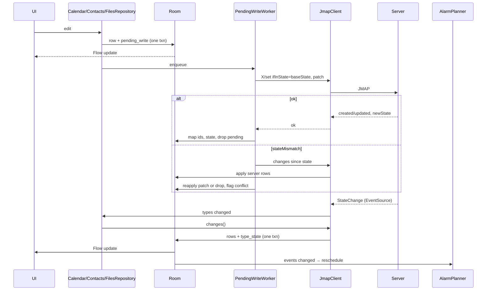

# Design: JMAP calendars, contacts write, files

Inputs: `REQUIREMENTS-jmap-server-features.md`; client read via codegraph (`JmapClient.contactChanges`, `ServerContactsSync`, `JmapSession`, `OutboxEntity`, Room v39); server read from `../postmarkapp2jmapserver/src/{calendar,filenode,itip,jmap}.rs`. Design only, no implementation.

## 0. Corrections to the requirements (found while reading the server)
| Req | Finding | Design consequence |
|---|---|---|
| F5 MDN | Server has **no** `urn:ietf:params:jmap:mdn` and no `MDN/send` (grep of `src/*.rs`: nothing). Sterna already sends RFC 8098 receipts as mail (`ReadReceiptMail.kt`, `OutboxEntity.requestReceipt`). | **F5 dropped as a JMAP feature.** Receipts already work on JMAP accounts over mail. Only the ask / always / never policy remains, and only if the existing UI lacks it (verify in settings during implement). |
| F7 `Email/parse` | Server has no `Email/parse` or `Blob/*`. It has `CalendarEvent/parse` (`blobIds`). | **F7 dropped.** Open-attached-.eml needs a different route (download blob, parse locally with `MimeParser`); out of this scope. |
| F2 "RRULE" | JSCalendar (RFC 8984) uses structured `recurrenceRules`, `recurrenceOverrides`, `excludedRecurrenceRules`, not RRULE strings. | Expander implements RFC 8984 `RecurrenceRule`, not RFC 5545 text. |

Remaining scope: **Calendars + tasks, local alarms, contacts write, Files.**

## 1. Existing seams reused
- `JmapSession` already carries `capabilities`, per-account `accountCapabilities`, `primaryAccounts`. Add `calendarsAccountId()` and `filesAccountId()` beside `contactsAccountId()` (same rule: capability present, primary account, else first advertising account, never the mail account).
- `Jmap.kt` constants: add `CALENDARS_CAPABILITY = urn:ietf:params:jmap:calendars`, `FILENODE_CAPABILITY = urn:ietf:params:jmap:filenode`.
- `JmapClient.contactChanges`/`readAllContacts` is a hand-rolled copy of the standard get-all / `/changes` / batched-`get` loop. Three new types need it, so extract it (section 2).
- Pattern to mirror from `ServerContactsSync`: sealed result per pass (`Imap`, `Linked`, `NoCapability`, `Refreshed`) for logging; null answer = no capability = write nothing; a throwing read leaves the cache as it was; `cannotCalculateChanges` → full replace.
- Push: `StateChange` over EventSource already wakes mail sync; extend its handler to schedule per-type syncs for the changed types.
- `MailFetchWorker` is where the address-book pass runs today; calendar/files passes join it.
- IMAP and `Linked` (shared/delegated) accounts never sync these types, as with contacts.

## 2. Component design

### 2.1 `:core:jmap`
```
JmapTypeSync<T>            // generic over the data type
  name: "CalendarEvent" | "Calendar" | "ContactCard" | "AddressBook" | "FileNode"
  properties: List<String>
  decode: (JsonObject) -> T
suspend fun JmapClient.getAll(session, accountId, auth, type): Snapshot<T>      // query+get, backref, paged by getBatchSize
suspend fun JmapClient.changes(session, accountId, auth, type, sinceState): Changes<T>  // changes loop, hasMoreChanges guard, notFound→destroyed, cannotCalculateChanges→replacesAll
suspend fun JmapClient.set(session, accountId, auth, type, ifInState, create, update, destroy, extra): SetResult
```
- `contactChanges`/`readAllContacts` become thin calls on this; existing `ContactsOnTheWireTest` and `ServerContactsRefreshTest` are the regression net and must pass unchanged before any new type is added.
- Types without `/query` support or with small collections (`Calendar`, `AddressBook`) use `/get` with `ids:null`.
- `set` returns per-id `notCreated/notUpdated/notDestroyed` mapped to a typed `SetError(type, description)`; `stateMismatch` is its own case.
- New models (all `@Serializable`, lenient decode, unknown properties kept as raw `JsonObject` so a round-trip edit does not drop fields the server stores):
  - `Calendar(id,name,color,isVisible,isDefault,timeZone,defaultAlertsWith[out]Time,myRights)`
  - `CalendarEvent(id,calendarIds,uid,title,start,duration,timeZone,showWithoutTime,status,recurrenceRules,recurrenceOverrides,excludedRecurrenceRules,participants,alerts,locations,description,@type,raw)`; a task is `@type=Task` (`due`, `progress`, `percentComplete`), same table.
  - `AddressBook`, `ContactCard(id,addressBookIds,name,emails,phones,addresses,raw)`
  - `FileNode(id,parentId,name,type,blobId,size,modified)` (`type` is the media type; folders have `blobId=null`).
- `CalendarEvent/parse` wrapper: `parseInvite(blobIds) -> events with iTIP method`.
- Blob transfer: reuse the existing upload/download paths in `JmapClient` (`uploadUrl`, `downloadUrl`); FileNode upload is upload-blob then `FileNode/set` create with `blobId`.

### 2.2 `:core:data`
Room, bump `SCHEMA_VERSION` 39→40 with a `MIGRATION_39_40` in `Migrations.kt` and an SQL migration test (as `ServerContactsMigrationSqlTest` does). Additive only.

| Table | Key | Columns of note |
|---|---|---|
| `calendar_cal` | (account, id) | name, color, visible, default, tz, rights |
| `calendar_event` | (account, id) | calendarId, uid, `startUtc`, `endUtc` (null+recurring flag when recurring), `isTask`, `recurring`, `title`, `json` (full object) |
| `contact_card` | (account, id) | addressBookId, `json`; `server_contacts` stays as the derived completion table, rebuilt from cards on every pass |
| `address_book` | (account, id) | name, default, rights |
| `file_node` | (account, id) | parentId, name, isDir, blobId, size, modifiedAt, cachedPath? |
| `type_state` | (account, type) | JMAP state string (generalises `ServerContactDao.state`) |
| `pending_write` | autoincrement | account, type, op (create/update/destroy), objectId or clientId, `patchJson`, `baseState`, attempts, lastError, state, createdAt |

Why `json` columns: JSCalendar and JSContact are wide and extensible; indexed columns hold only what queries filter on (time range, calendar, parent). Unknown fields survive edits.

Repositories (one seam each, like `MailRepository`): `CalendarRepository`, `ContactsRepository` (extends today's contacts sync), `FilesRepository`. Each exposes `Flow` from Room; the network only writes Room (same rule as mail).

Sync pass per type: read `type_state`; null → `getAll` + replace; else `changes` + apply; `replacesAll` → replace; state advanced in the same Room transaction as the rows (as `replaceAll(accountId, rows, state)` does today).

### 2.3 Offline write queue (generic)
- User action → write Room optimistically + insert `pending_write` in one transaction → UI updates at once.
- `PendingWriteWorker` (WorkManager, network constraint, unique per account) drains in order: `X/set` with `ifInState = baseState`; on success store server `id` for client-created rows (replace the local temp id everywhere it is referenced) and advance state; on `stateMismatch` run a sync pass for that type, re-apply the pending patch if the target still exists, else drop it with a visible message; on permanent `SetError` mark `FAILED` and surface it; transient errors back off.
- Patches are JMAP JSON-pointer patches built from the edited fields only, so a concurrent server edit to another field survives.
- Creation uses client ids (`#c1`), mapped after the response; an update to a not-yet-created object waits on its create.
- Mirror `OutboxState` wording tests for the user-facing states (queued / sending / failed).
- Not reused: `OutboxEntity` is mail-specific (recipients, MIME entity paths). A second small queue is cheaper than bending it.

### 2.4 Recurrence expander (`core/data/calendar`, pure Kotlin, JVM tests)
- Input: event JSON, time zone database (`java.time`), window `[from,to)`. Output: occurrences (`start`, `end`, `recurrenceId`, overridden fields applied).
- Supports `frequency` yearly..daily (not sub-daily in v1; ceiling stated), `interval`, `count`, `until`, `byDay/byMonthDay/byMonth/bySetPosition`, `firstDayOfWeek`, `recurrenceOverrides` (patch, `excluded`), `excludedRecurrenceRules`. Unsupported rule → show first instance only and mark "repeats (not shown)" instead of silent wrong data.
- DST: expand in the event's own `timeZone`, convert to UTC afterwards; `showWithoutTime` events expand as dates.
- Safety: hard caps on instances per event and on window length.
- The existing `ICalendar.kt` (local `.ics` card) stays as the fallback when no calendars capability.

### 2.5 Reminders (`:app`, `push/` neighbours)
- `AlarmPlanner` (pure): from synced events, next N (e.g. 7 days) alarm instants (`OffsetTrigger` relative to start/end, `AbsoluteTrigger`; `action` display only; `email` alarms ignored).
- `AlarmScheduler`: `AlarmManager` `PendingIntent` per alarm, rolling horizon; re-plan on sync, daily worker, `BOOT_COMPLETED`, `TIMEZONE_CHANGED`, `TIME_SET`. Receiver posts a notification on its own channel.
- Exact alarms: request `SCHEDULE_EXACT_ALARM`; if not granted use `setAndAllowWhileIdle` and say so in settings. Moderate confidence on Android 14+ policy; verify against current docs in implement.
- Settings: per-account on/off; default off until the user opens the calendar once (no surprise notifications).

### 2.6 UI (`:app/ui/calendar`, `ui/contacts`, `ui/files`)
- Drawer entries appear only when the active JMAP account advertises the capability; absent → nothing, no requests.
- **Calendar**: one screen, Events / Tasks toggle; Agenda and Month; day sheet; event detail; editor (title, time, all-day, tz, calendar, repeat, participants, alerts, notes). Calendar list with visibility toggles (`Calendar/set isVisible`).
- **Invite card in a message** (existing): when capability present, `CalendarEvent/parse` the `.ics` blob (or `uid` lookup), show RSVP buttons; RSVP = `CalendarEvent/set` update of my `participants/<id>/participationStatus` with `sendSchedulingMessages:true` (server writes the iMIP reply). When the event is not in the calendar yet: create from parse result, then RSVP. Without capability: today's "Add to calendar" behaviour.
- **Contacts**: list + editor (name, emails, phones, addresses, book picker); `stateMismatch` shows "changed on the server, reloaded".
- **Files**: folder browser, open/download (blob), upload (SAF picker, progress via WorkManager), rename/move/delete, composer "Attach from Files" reusing the picker.
- Navigation through existing `NavHost`; follow `Motion.kt` caps (a test enforces them).

## 3. Data flow


## 4. Staged delivery (maps to `IMPLEMENTATION_PLAN.md`)
| Stage | Deliverable | Verify |
|---|---|---|
| 1 | `JmapTypeSync` extraction; contacts migrated onto it | Existing contacts tests green unchanged |
| 2 | Calendar read: models, Room, sync, expander, Agenda/Month, push wiring | Expander table tests incl. DST; sync tests against fixtures; manual against reference server |
| 3 | Generic `pending_write` queue + worker | Queue tests: replay, `stateMismatch`, dependent create→update |
| 4 | Contacts write | Edit offline, replay, conflict message; completion table rebuilt |
| 5 | Calendar write + invite RSVP (`parse`, `sendSchedulingMessages`) | Round trip with reference server; invite card with and without capability |
| 6 | Tasks toggle | Task create/complete/due round trip |
| 7 | Alarms | Planner tests; reboot, tz change, doze on device |
| 8 | Files browse/download/upload + composer attach | Upload limit from `maxSizeUpload`; large file survives restart |

Stages 1–3 ship nothing user-visible beyond read-only calendar; each stage compiles and passes tests on its own.

## 5. Risks and ceilings
- Reference server not field-tested (its README). Fixtures from its own tests (`calendars_over_jmap`, `filenode`) are the first wire truth; drift from other servers is limited by gating, not eliminated.
- No sub-daily recurrence, no availability (`Principal/getAvailability`), no calendar sharing, no email alarms: stated ceilings.
- `json` columns mean no SQL filtering on participants/locations; fine for current screens, revisit if search over events is wanted.
- Conflict policy is per-field patch + `ifInState`; a same-field concurrent edit loses to the server with a message (accepted in requirements).
- Large event sets: initial `getAll` paged by `getBatchSize`; expansion windowed. A calendar with many thousand recurring events needs measuring.
- New permissions: notifications (already present for mail), exact alarms, `RECEIVE_BOOT_COMPLETED` (check manifest; push fallback may already hold it).

## 6. Test strategy
Pure JVM for `core:jmap` (wire tests with canned JSON, like `ContactsOnTheWireTest`) and the expander/planner; Room SQL tests for migration and queries; worker logic against fake DAOs and a fake `JmapClient`; UI tests for capability gating (no entry, no request when absent). Guards are verified by breaking them and watching a named test fail, per the server repo's convention.

## 7. Open items for implementation
1. Confirm in settings whether an ask/always/never read-receipt policy already exists (F5 residue).
2. Verify Android 14+ exact-alarm policy and Play/F-Droid distribution constraints before choosing `SCHEDULE_EXACT_ALARM` vs `USE_EXACT_ALARM`.
3. Read `CalendarEvent/get` property list and `ParticipantIdentity` shape in `calendar.rs` when writing the models.
4. Decide whether `FileNode` content is cached on disk (offline open) or fetched on demand; default on demand with a small LRU.
